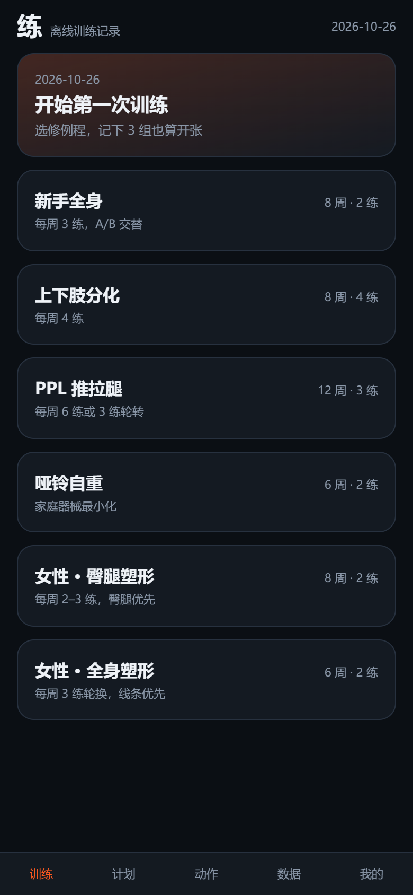
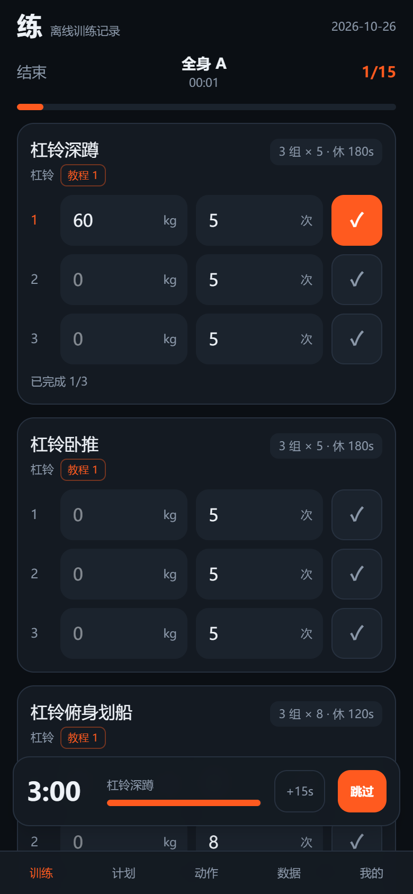
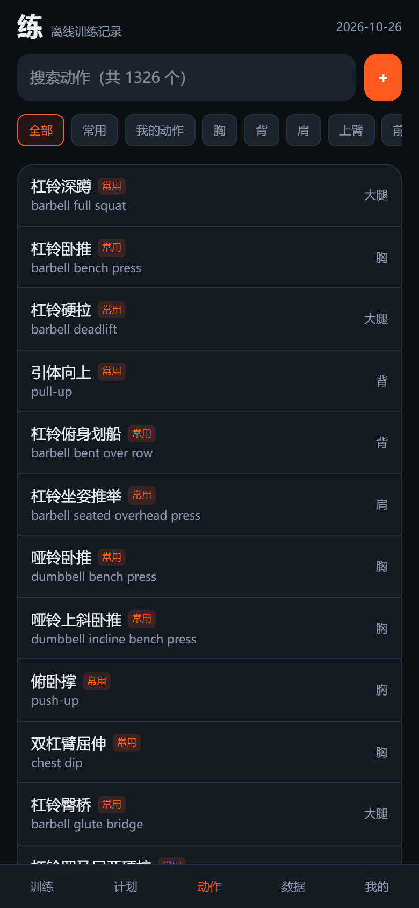
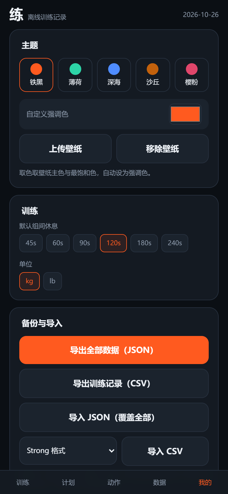
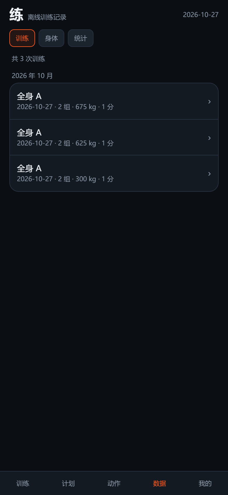
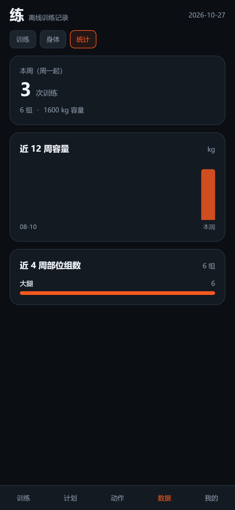

# 练 · Lian

[](https://github.com/redoneli-create/ironlog/releases/latest)
[](https://github.com/redoneli-create/ironlog/actions/workflows/android.yml)

离线优先的健身记录 PWA：React + TypeScript + Vite + Tailwind + Dexie。纯前端、无后端、可安装，数据只存本机。

| 首页 | 训练中 |
| --- | --- |
|  |  |

| 动作库（常用优先） | 设置 |
| --- | --- |
|  |  |

| 训练历史（含 PR） | 周统计 |
| --- | --- |
|  |  |

## 功能

- **训练**：6 套内置计划（新手全身 / 上下肢 / PPL / 哑铃自重 / 女性臀腿塑形 / 女性全身塑形）+ 自定义计划、例程、超级组；训练中一屏打勾
- **组间计时**：完成组自动起表；全局默认 / 动作 / 组三级覆盖（+15s、跳过）；`Date.now` 校准，切后台或刷新不丢；结束蜂鸣 + 震动
- **动作教程**：任意动作可挂 B 站 / 抖音 视频链接，训练中一键打开；常用动作预置 B 站搜索链接，可删可改
- **动作库**：1324 个内置动作，全部中文名（英文原名保留为副标题）；常见动作置顶并标「常用」，支持按部位、器械、别名搜索
- **健身房叫法**：蝴蝶机、鹦鹉螺、倒蹬机、高位下拉、山羊挺身……口语/器械别名都能搜到（`src/data/aliases.ts`，可自行补充）
- **进阶建议**：幽灵数据预填上次重量次数、e1RM、加重/加次建议、首页单信号
- **身体数据**：体重 / 体脂记录 + 趋势图
- **主题**：5 套预设、自定义强调色、壁纸取主色
- **历史与洞察**：训练历史按月分组、每次训练明细、动作级历史与 PR 标记；近 12 周容量柱状图、近 4 周部位组数分布
- **可靠性**：训练中屏幕常亮（Wake Lock）、后台休息结束发系统通知、14 天未备份在首页提醒导出
- **误删可撤销**：删训练/例程/计划/动作/体重记录/教程链接均可在 Toast 里撤销
- **备份**：JSON 全量导出 / 导入；CSV 导出；FitNotes / Strong CSV 导入
- **PWA**：可安装、离线可用（Workbox 预缓存）
- **APK**：内置 Capacitor 工程，可打包成 Android 安装包（[docs/APK.md](docs/APK.md)）

## 下载 APK（Android）

直接装到手机，不用电脑、不用自己编译：

**https://github.com/redoneli-create/ironlog/releases/latest** → 展开 **Assets** → 下载 `app-debug.apk` → 传到手机安装（允许「未知来源」）。

> 这是 debug 签名包：自用/发给朋友都没问题，上架应用商店需要自己重新签名。
> iOS 用户请用 PWA：部署后 Safari 打开 → 共享 → 添加到主屏幕。

## 快速开始

```bash
npm i
npm run dev      # http://localhost:5173
npm run build    # 产出 dist/ + Service Worker
npm run preview
```

手机安装：同一局域网打开 `http://<电脑IP>:5173` 可试用；正式安装需要 HTTPS（Netlify / Vercel 直接拖 `dist/`，或 GitHub Pages 需先把 `vite.config.ts` 的 `base` 设为 `"./"`）。

## 打包成 Android APK

仓库已包含 `android/`（Capacitor 8）与 CI 工作流，三条路任选：

1. **GitHub Actions（推荐）**：推到 GitHub → Actions → *Build Android APK* → Run workflow → 下载 `lian-apk` 产物
2. **本地 Android Studio**：`npm run build:android` → `npm run android:open` → Build APK
3. **PWABuilder（TWA）**：需要已部署的 HTTPS 地址，无需本地环境

> APK 与浏览器是两套独立存储：切换到 APK 前，先在网页版「我的 → 导出全部数据（JSON）」，装好后导入。

细节见 [docs/APK.md](docs/APK.md)。

## 数据存储

IndexedDB（Dexie，库名 `ironlog`，改名不会丢数据），表：`exercises / routines / programs / sessions / metrics / settings`。
JSON 备份包含以上全部表（含自建动作的教程链接）；CSV 导出列为 Strong 兼容格式，可直接回导。

## 动作中文名

内置动作的中文名由 `scripts/zh_names.py` 按「器械 + 姿势 + 动作」词表规则生成（1324/1324 已覆盖，少数专有名词保留英文），默认计划用到的动作有人工校对表；重新生成：

```bash
python scripts/zh_names.py
```

## 动作数据与许可边界

- 动作元数据（名称、部位、器械、目标肌群、协同肌群）来自 [hasaneyldrm/exercises-dataset](https://github.com/hasaneyldrm/exercises-dataset)，数据文件为 MIT，© Hasan Emir Yıldırım。
- 该仓库的缩略图与动画 GIF 版权归 **Gym visual**（https://gymvisual.com/），受其使用条款约束。
- 本项目**不打包、不分发任何动作图片 / GIF**，仅复用文本元数据。教程链接指向第三方平台（B 站 / 抖音）的公开页面，版权归原作者，应用本身不托管视频。

## 代码结构

```
src/
  lib/db.ts         数据模型 + Dexie schema + 常量
  lib/session.ts    会话生命周期 / 组状态
  lib/rest.ts       计时器（持久化 + 提醒）
  lib/metrics.ts    幽灵数据 / e1RM / 建议 / 单信号
  lib/tutorials.ts  教程链接（B 站 / 抖音识别）
  lib/backup.ts     JSON 与 CSV 导入导出
  lib/theme.ts      预设主题 / 壁纸取色
  screens/          Train · Plans · Library · Body · Me
  components/       UI 基础件、动作选择器、计时条、教程列表
scripts/zh_names.py 动作中文名生成
```

## License

MIT
